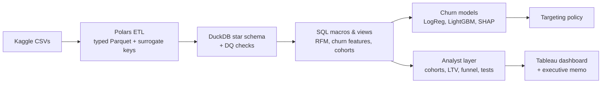
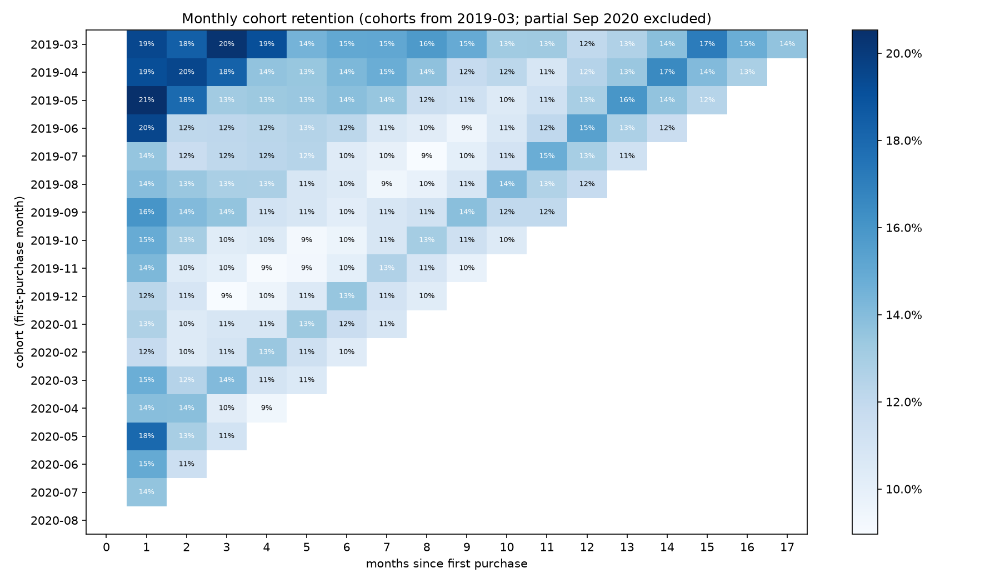

# Customer Retention & Churn Intelligence Platform

End-to-end retention analytics on the **H&M Personalized Fashion Recommendations** dataset
(31.8M transactions, 1.36M customers, Sep 2018 – Sep 2020): a tested DuckDB warehouse, a
leakage-safe churn model with value-aware targeting, and an analyst layer with cohorts, LTV,
hypothesis tests, an A/B test design, a Tableau dashboard and an executive memo.

**📊 [Interactive Tableau dashboard](https://public.tableau.com/app/profile/harshit.mittal8614/viz/HMCustomerRetentionLifetimeValue/Dashboard1)** ·
**📄 [Executive memo](reports/exec_memo.md)** · **🧭 [Decision log](notes/decisions.md)**

## Headline results

| Area | Result |
| --- | --- |
| Data pipeline | 3.5 GB CSV → 162 MB Parquet in 8 s; 9 automated data-quality checks; all benchmark queries < 0.25 s on 28.8M rows |
| Churn model (held-out test) | LightGBM PR-AUC **0.714** vs 0.411 baseline; **2.05× lift** in top decile; +0.013 over logistic regression (95% CI 0.013–0.014) |
| Targeting (simulation) | Expected-value targeting stayed profitable on a held-out period; ranking the same customers by churn risk lost value |
| Biggest leak | **38%** of new customers never make a second purchase within a year (median 52 days to 2nd purchase) |
| Strongest driver | Incomplete loyalty-club sign-up: 37% vs 64% 12-month repeat (Cohen's h = 0.55) |
| Concentration | 22% of customers (Champions) generate **58%** of revenue |

## Architecture



## Quick start

```bash
brew install uv libomp
uv sync
# Kaggle token in ~/.kaggle/access_token, competition rules accepted
make pipeline          # download → ETL → warehouse → churn → analyst exports
uv run python -m hmci.churn.final_test   # held-out test, run once
make test              # leakage and data-quality tests
```

**Data:** Kaggle competition data is not redistributed in this repo; `make download` fetches it with your own Kaggle account.

## 1. Data layer
- **ETL:** Polars streaming read with explicit types, int32 surrogate keys, identical rows collapsed into a `units` column (31,788,324 raw rows → 28,813,419, verified by sum).
- **Warehouse:** DuckDB star schema (`fact_sales`, `dim_customer`, `dim_article`, `dim_date`, `dim_channel`) with 9 checks: orphan keys, duplicate keys, row and unit totals, non-positive revenue.
- **Benchmarks:** [reports/benchmarks.md](reports/benchmarks.md). No engine wins everywhere: DuckDB native tables fastest on joins (0.069 s), Polars on per-customer distinct counts (0.057 s).
- **Data dictionary:** generated from the live schema: [docs/data_dictionary.md](docs/data_dictionary.md).

## 2. Churn prediction
<!-- paste the Module 2 section from earlier here, starting at "**Question:**" -->

## 3. Customer analytics

**Question:** who stays, who leaves, what are they worth, and what should we do?

### Cohort retention and value
- About **1 in 7** new customers buys again in any given later month; spring cohorts are worth more (12-month value 0.343 for Mar 2019 vs 0.251 for Jul 2019).
- **Store-first customers return more** (12-month repeat 67.1% vs 59.5%), **but online-first customers are worth more on average** (12-month value +20%), driven by larger first baskets and a high-spending minority (P(online > store) = 0.52).
- Channel 2 is confirmed as online: **100%** of April 2020 new customers bought through it while stores were closed.



### Repeat-purchase funnel (first 365 days, 292k customers)
| Step | Share of new customers | Step conversion |
| --- | --- | --- |
| 2nd purchase | 61.8% | 61.8% |
| 3rd purchase | 42.7% | 69.1% |
| 5+ purchases | 22.0% | 51.6% |

### Hypothesis tests (Benjamini–Hochberg corrected)
| Finding | Difference | Effect size |
| --- | --- | --- |
| Club ACTIVE vs PRE-CREATE, 12-month repeat | +27.0 pp | h = 0.55 (medium) |
| Newsletter subscribers vs not | +12.0 pp | h = 0.25 (small) |
| Store-first vs online-first | +7.6 pp | h = 0.16 (small) |
| Entry product group | 6.3 pp range | V = 0.02 (negligible) |
| Lockdown cohort vs March 2020, 90-day repeat | +0.3 pp, **p = 0.37** | no effect |

With 100k+ customers nearly everything is significant, so findings are ranked by effect size. The lockdown test **overturned** an earlier eyeballed conclusion based on month-3 retention, which was confounded by calendar timing.

### Myths checked
- **Omnichannel customers spend 3.3× more** only because they buy more often; within the same frequency band, online-only customers spend more.
- **What customers buy first** barely predicts whether they return.

### A/B test design for the retention offer
Pre-registered plan: [docs/ab_test_plan.md](docs/ab_test_plan.md). 9,335 customers per arm detect a 2 pp lift from a 60% baseline (α = 0.05, power = 0.80). Simulating 1,000 experiments showed that requiring the point estimate to clear the MDE cuts power from 82% to 49%, so the decision rule is "ship if the 95% CI excludes 0".

### Recommendations
See the [executive memo](reports/exec_memo.md): win the second purchase within ~50 days, test a club sign-up completion prompt, target offers by expected value, protect Champions and Loyal customers.

## Limitations
- Spend is in the dataset's scaled units, not currency.
- Club and newsletter flags are recorded at the end of the period, so their effects are associations, not causes.
- Retention-offer value is simulated: the save rate and offer cost are assumptions until the A/B test runs.
- Single-machine pipeline; not run on a distributed cluster.

## Repository structure
```
sql/            star schema, macros, churn features, analyst views
src/hmci/       etl/, churn/, analyst/, common/
tests/          leakage, split-purging and ETL tests
reports/        results tables, figures, Tableau exports, executive memo
docs/           data dictionary, A/B test plan
notes/          decision log
```
